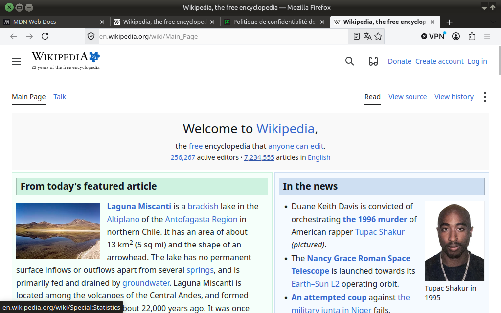
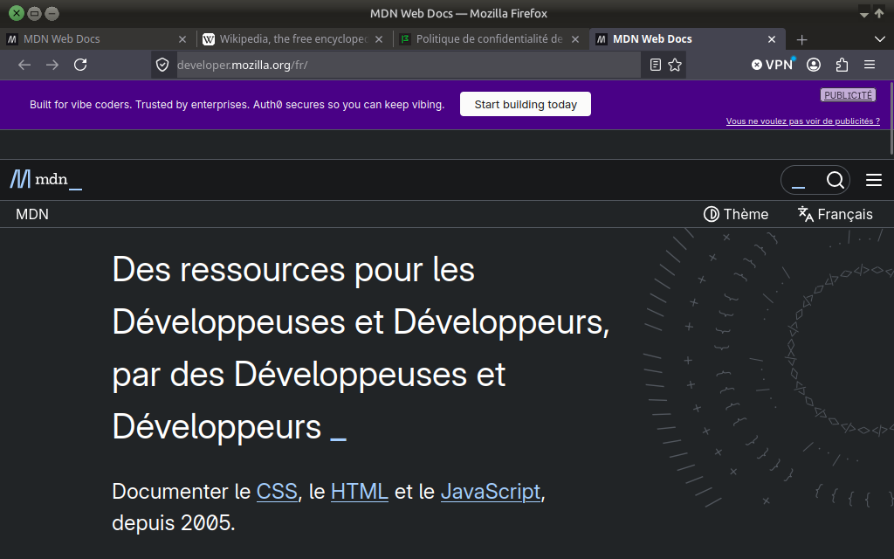

# Firefox Photon — Thème Brut & Low-Tech

Thème CSS ultra-léger et épuré pour Firefox, inspiré de l'ergonomie **Photon** historique : angles vifs (radius 2px), onglets connectés à 25px, typographie compacte et contrastes francs.

---

## Aperçu

### Variante Claire (Active par défaut)


### Variante Sombre (Vert Organique)


---

## Prérequis Indispensable

Dans Firefox, ouvrez **Paramètres > Extensions et thèmes** (ou tapez `about:addons`), puis dans l'onglet **Thèmes** :
- Assurez-vous que seul le **« Thème système — auto »** est activé.
- Désactivez tout thème tiers ou thème prédéfini Firefox (Alpenglow, etc.) pour éviter les conflits de variables.

---

## Installation Automatique (Recommandée)

### Sous Linux & macOS
Ouvrez un terminal dans le dossier du dépôt et lancez :
```bash
chmod +x install.sh && ./install.sh
```
*Le script détecte automatiquement votre profil Firefox, crée le dossier `chrome/`, copie les fichiers et active les options requises dans `user.js`.*

### Sous Windows
Double-cliquez simplement sur :
- **`install.bat`** (ou faites un clic droit > *Exécuter avec PowerShell* sur `install.ps1`).

---

## Installation Manuelle (Alternative)

1. Tapez `about:support` dans Firefox.
2. À la ligne **Dossier de profil**, cliquez sur **Ouvrir le dossier correspondant**.
3. Créez un dossier nommé `chrome` et copiez-y `userChrome.css` et le dossier `variantes/`.
4. Copiez `user.js` à la racine de votre dossier de profil.
5. Ouvrez `about:config` et passez `toolkit.legacyUserProfileCustomizations.stylesheets` à `true`.
6. Redémarrez Firefox.

---

## Basculer entre Thème Clair et Thème Sombre

La **variante claire est active par défaut**.

Pour passer en mode sombre, ouvrez `userChrome.css` (dans le sous-dossier `chrome/`) et décommentez la ligne correspondante :

```css
/* ==========================================================================
   USERCHROME.CSS - CHOIX DE LA VARIANTE
   ========================================================================== */

/* 1. VARIANTE CLAIRE (ACTIVE PAR DÉFAUT) */
/* @import "variantes/variables-clair.css"; */

/* 2. VARIANTE SOMBRE (PHOTON VERT & ACCENTS ORGANIQUES) */
@import "variantes/variables-sombre.css";
```
Puis redémarrez Firefox.

---

## Personnalisation (Design Tokens à 2 Niveaux)

Toutes les couleurs et dimensions se règlent dans les fichiers de variables (`variantes/variables-clair.css` ou `variantes/variables-sombre.css`) :

- **Niveau A (Variables Générales) :** Changez `--text-on-dark`, `--surface-dark-bg`, `--accent-solid`, `--general-radius: 2px;` ou `--tab-height: 25px;` pour rethématiser l'ensemble de Firefox en un instant.
- **Niveau B (Variables Spécifiques) :** Chaque composant (marque-pages, traductions, moteurs de recherche, sécurité) hérite du Niveau A mais reste ajustable individuellement.

---

## Test local (Xephyr)

Prévisualisez les thèmes sans impacter votre profil principal :
```bash
./run_test.sh light   # Test du thème clair
./run_test.sh dark    # Test du thème sombre
```
